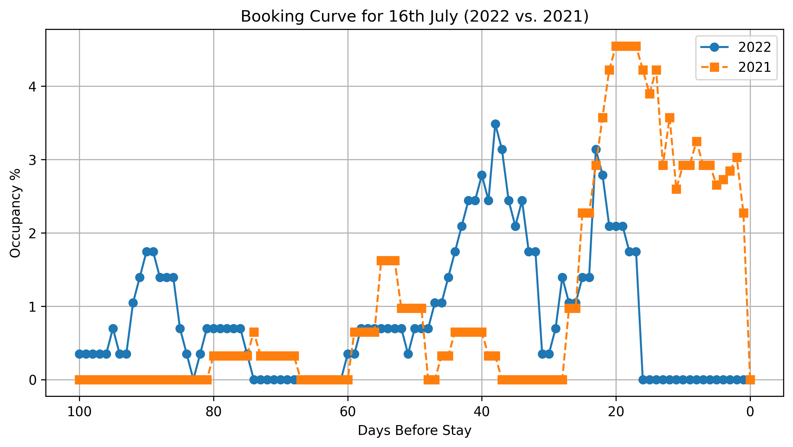

# 📊 RoomPriceGenie Coding Challenge - Booking Curve Analysis

## 📌 Overview
This repository contains my solution for the **RoomPriceGenie Python coding challenge**.  
The task involves **analyzing hotel reservation data** and computing a **Booking Curve** to compare occupancy trends for **July 16, 2022, vs. July 16, 2021**.

## 🚀 Solution Approach
### 1️⃣ **Data Preprocessing**
- Converted date columns (`NIGHT_OF_STAY`, `DATE_OF_RESERVATION`, `CANCELLATION_DATE`) to **datetime format**.
- Removed duplicate reservations based on `ROOM_RESERVATION_ID`, keeping only the **earliest modification**.
- Filtered out reservations **canceled before the stay date**.

### 2️⃣ **Computing the Booking Curve**
- Calculated the number of **days before the stay** each reservation was made.
- Counted **bookings per day** within **100 days before** the stay date.
- Normalized occupancy percentage **based on unique booked rooms**.

### 3️⃣ **Visualization**
- Plotted **2022 vs. 2021 trends** on a single graph.
- **X-axis:** Days before stay (from **100 to 0**).
- **Y-axis:** Occupancy percentage (**normalized by total available rooms**).
- Saved the final visualization as **`booking_curve.png`**.

## 🛠 Installation & Running the Notebook
To execute the Jupyter Notebook locally:

### **1️⃣ Clone the repository**
```sh
git clone https://github.com/amalgmar/RoomPriceGenie-Booking-Curve.git
cd RoomPriceGenie-Booking-Curve
```
---

## 🛠 Installation & Running the Notebook

### **2️⃣ (Optional) Create a Virtual Environment**
Setting up a virtual environment is recommended to isolate dependencies.

#### **Mac/Linux**
```sh
python3.13 -m venv venv
source venv/bin/activate
```


#### **Windows**
```sh
python3.13 -m venv venv
venv\Scripts\activate
```

### 3️⃣ Install Dependencies
Ensure all required libraries are installed by running:

```sh
pip install -r requirements.txt
```

### 4️⃣ Run the Jupyter Notebook
Start Jupyter Notebook with the following command:

```sh
jupyter notebook
```
Then, open booking_curve.ipynb and execute the cells.

## 📊 Booking Curve Visualization
The following chart represents the final visualization generated from the analysis: